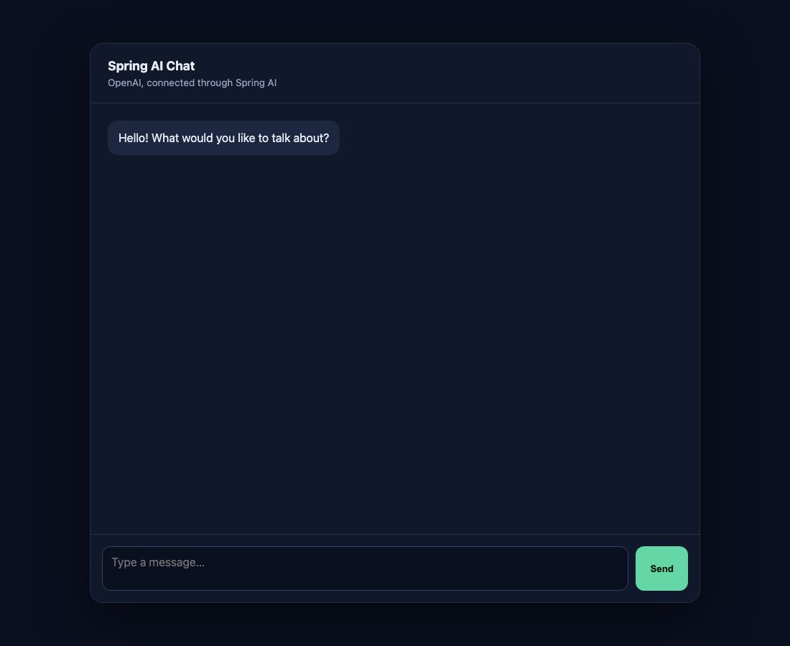

# Spring AI OpenAI Chat

A small Spring Boot web application that chats with an OpenAI model through [Spring AI](https://spring.io/projects/spring-ai). It exposes a validated REST endpoint and ships with a single-page chat UI served by the same application.



## Features

- Chat with an OpenAI model via Spring AI's `ChatClient`
- `POST /api/chat` JSON endpoint with request validation (non-blank, max 10,000 characters)
- Built-in dark-themed chat page, no separate frontend build
- Model configurable through an environment variable
- Controller tests with `@WebMvcTest` (no API key or network needed)

## Tech stack

- Java 17
- Spring Boot 3.5
- Spring AI 1.1 (`spring-ai-starter-model-openai`)
- Maven
- Plain HTML/CSS/JavaScript for the UI

## Architecture

```
Browser (static/index.html)
        │  POST /api/chat  {"message": "..."}
        ▼
ChatController      validates ChatRequest (@Valid), maps to ChatResponse
        │
        ▼
ChatService         wraps Spring AI ChatClient with a default system prompt
        │
        ▼
OpenAI API          model set by OPENAI_MODEL
```

| Class | Role |
| --- | --- |
| `SpringAiChatApplication` | Spring Boot entry point |
| `chat/ChatController` | REST layer, exposes `POST /api/chat` |
| `chat/ChatService` | Builds the `ChatClient` and sends the user message to the model |
| `chat/ChatRequest` | Request record with Bean Validation constraints |
| `chat/ChatResponse` | Response record, `{"reply": "..."}` |
| `static/index.html` | Chat UI that calls the API with `fetch` |

Each request is independent: the application does not keep conversation history on the server.

## Getting started

### Prerequisites

- JDK 17 or newer
- Maven 3.9+ (or use your IDE's Maven support)
- An [OpenAI API key](https://platform.openai.com/api-keys)

### Run

```bash
git clone https://github.com/FranckAymar/spring-ai-chat-openai.git
cd spring-ai-chat-openai

export OPENAI_API_KEY=your-api-key
mvn spring-boot:run
```

Open <http://localhost:8080> and start chatting.

### Configuration

| Variable | Required | Default | Description |
| --- | --- | --- | --- |
| `OPENAI_API_KEY` | yes | none | Your OpenAI API key |
| `OPENAI_MODEL` | no | `gpt-5.6` | Model used for chat completions |

The API key is read from the environment and is never committed to the repository.

### Call the API directly

```bash
curl -X POST http://localhost:8080/api/chat \
  -H "Content-Type: application/json" \
  -d '{"message": "Explain Spring AI in one sentence."}'
```

```json
{ "reply": "..." }
```

A blank or oversized message returns `400 Bad Request` with a validation message.

### Run the tests

```bash
mvn test
```

## Possible next steps

- Per-session conversation memory
- Streaming responses to the UI
- Swapping providers (Spring AI supports other model backends)
